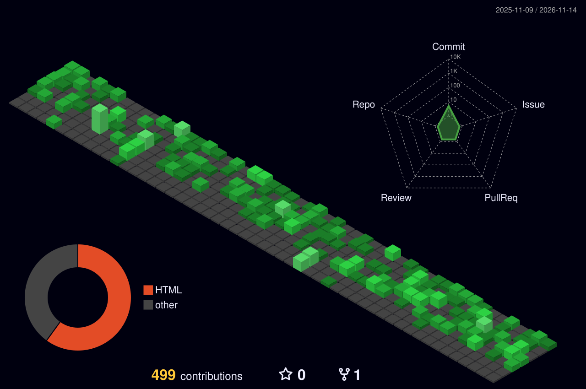

# Khan Mohammad Emon

**Junior Software Engineer at Alice Labs** · Full-Stack Developer

## About

I'm a software engineer at **Alice Labs**. I build and maintain features on a production AI-agent platform using React, TypeScript and Django, and I track down production issues across the whole stack, from the UI to the database, background jobs and third-party integrations.

I'm also the first author of a peer-reviewed IEEE paper on deep learning for breast cancer histopathology.

- **Now:** full-stack work on a production AI-agent platform
- **Strengths:** finding root causes across frontend, backend and data layers
- **Research interests:** machine learning, deep learning, medical imaging

## Tech Stack

  

| Area | Tools |
| --- | --- |
| **Languages** | JavaScript (ES6+), TypeScript, Python, PHP, Java, C/C++, Bash |
| **Web & Frameworks** | React, Django, FastAPI, REST APIs, Tailwind CSS, HTML, CSS |
| **Databases** | PostgreSQL, MySQL, MongoDB, ClickHouse |
| **Tools** | Git, GitHub, Postman, Kibana, Jira, LaTeX |
| **AI / ML** | PyTorch, Keras |
| **Familiar with** | Docker, CI/CD |

## Experience

### Junior Software Engineer · Alice Labs Pte. Ltd.
*Aug 2025 – Present*
- Develop and maintain features on a production **AI-agent platform** using React, TypeScript, Django and REST APIs.
- Investigate and resolve production issues involving the frontend, backend, databases, asynchronous jobs, webhooks and third-party integrations.
- Trace client-facing problems to their root cause across frontend and backend layers, and ship reliable fixes.
- Work with engineering, QA and product teams to deliver and review production changes.

### Software Engineering Intern · Alice Labs Pte. Ltd.
*Feb 2025 – Jul 2025*
- Supported the frontend team on a production project while learning React and FastAPI.
- Configured and enforced **ESLint** rules across the core product and resolved the resulting conflicts.
- Worked with a white-label partner to customize client websites.
- Updated project documentation and Git workflows to make onboarding easier for new developers.

### Grader · United International University
*Nov 2022 – Jan 2024*
- CSE 3521: Database Management Systems (Fall 2022)
- IPE 3401: Industrial and Operational Management (Fall 2023)
- MATH 1151: Fundamental Calculus (Fall 2023)

## Publication

**ENRNN-AU-Net: A Hybrid Deep Learning Model to Classify and Segment Histopathology Images of Breast Cancer** 
**K. M. Emon**, G. Kibria, Md. Shakhan, B. J. F. Hafiz, R. Azim 
*2024 International Conference on Advances in Computing, Communication, Electrical, and Smart Systems (iCACCESS)*, IEEE 
[Paper](https://ieeexplore.ieee.org/abstract/document/10499623/) · [Code](https://github.com/KhanMohammadEmon/ENRNN-AU-Net)

## Achievements

- 🏆 **ICPC 2022 Asia Dhaka Regional**: competed with Team Songshoptok
- 🎓 **Academic scholarships** at UIU: 50% once, 25% twice

## Contributions

<picture>
  <source media="(prefers-color-scheme: dark)" srcset="./profile-3d-contrib/profile-night-green.svg">
  <source media="(prefers-color-scheme: light)" srcset="./profile-3d-contrib/profile-green.svg">
  
</picture>

---

<i>Open to collaborating on web products and applied ML. Feel free to reach out.</i>

