# Khan Mohammad Emon

**Junior Software Engineer at Alice Labs** · Full-Stack Developer

### 👨‍💻 About

I build and maintain features on a production **AI-agent platform** at Alice Labs using React, TypeScript and Django, and I track down production issues across the stack, from the UI to databases, background jobs, webhooks and third-party integrations.

- 🔧 **Now:** full-stack work on a production AI-agent platform
- 🔍 **Strength:** finding root causes across frontend, backend and data layers
- 🧠 **Research:** deep learning for medical imaging ([IEEE, 2024](https://ieeexplore.ieee.org/abstract/document/10499623/))
- 🏆 **Competitive programming:** ICPC 2022 Asia Dhaka Regional

 

### 🛠️ Tech Stack

  

Also: ClickHouse · Kibana · Keras · Jira · LaTeX · Docker &amp; CI/CD (familiar)

### 💼 Experience

**Junior Software Engineer** · Alice Labs Pte. Ltd. · Aug 2025 – Present
- Develop and maintain features on a production AI-agent platform using React, TypeScript, Django and REST APIs.
- Resolve production issues spanning the frontend, backend, databases, async jobs, webhooks and third-party integrations.
- Trace client-facing problems to their root cause and ship reliable fixes, working with engineering, QA and product.

<b>Software Engineering Intern</b> · Alice Labs Pte. Ltd. · Feb 2025 – Jul 2025

- Supported the frontend team on a production project while learning React and FastAPI.
- Configured and enforced **ESLint** rules across the core product and resolved the resulting conflicts.
- Worked with a white-label partner to customize client websites.
- Updated project documentation and Git workflows to make onboarding easier for new developers.

<b>Grader</b> · United International University · Nov 2022 – Jan 2024

- CSE 3521: Database Management Systems
- IPE 3401: Industrial and Operational Management
- MATH 1151: Fundamental Calculus

### 📄 Publication

**ENRNN-AU-Net: A Hybrid Deep Learning Model to Classify and Segment Histopathology Images of Breast Cancer** 
**K. M. Emon**, G. Kibria, Md. Shakhan, B. J. F. Hafiz, R. Azim · iCACCESS 2024, IEEE · [Paper](https://ieeexplore.ieee.org/abstract/document/10499623/) · [Code](https://github.com/KhanMohammadEmon/ENRNN-AU-Net)

### 📈 Contributions

<picture>
  <source media="(prefers-color-scheme: dark)" srcset="./profile-3d-contrib/profile-night-green.svg">
  <source media="(prefers-color-scheme: light)" srcset="./profile-3d-contrib/profile-green.svg">
  
</picture>
